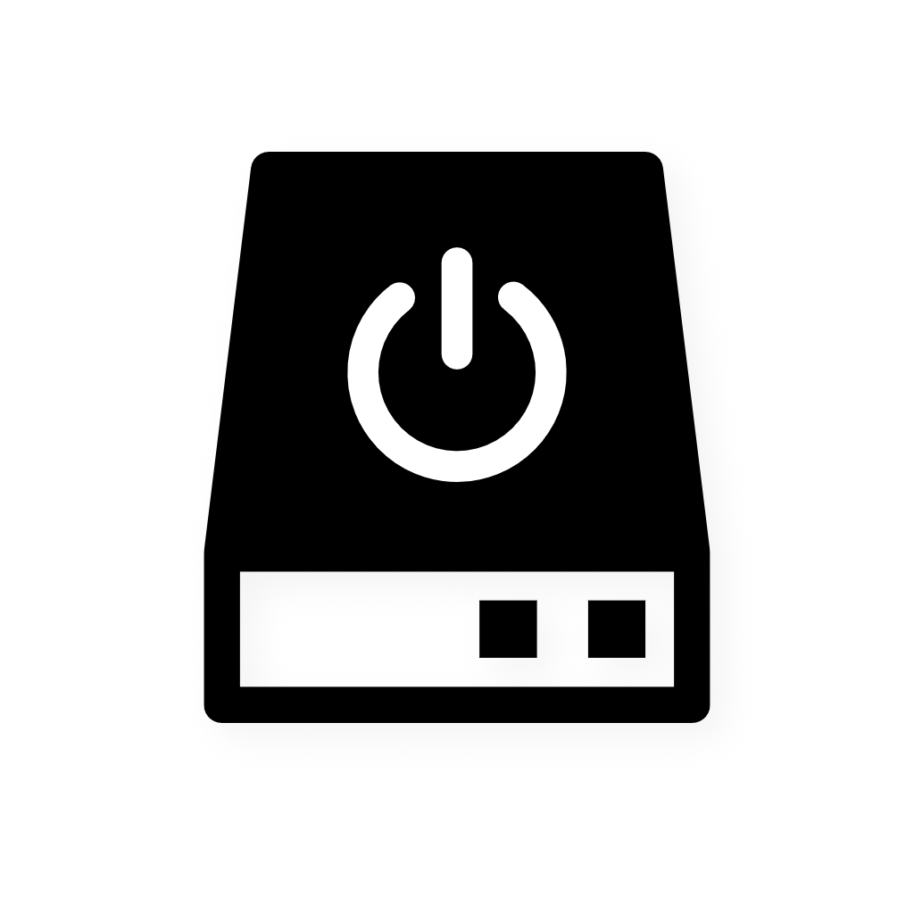
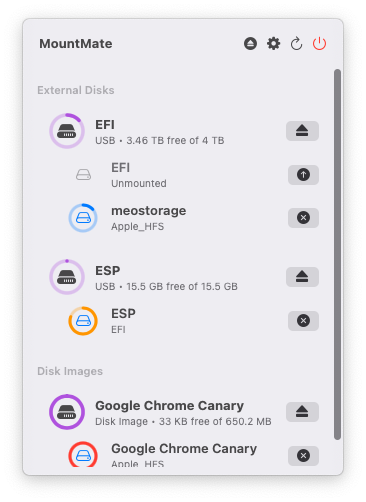
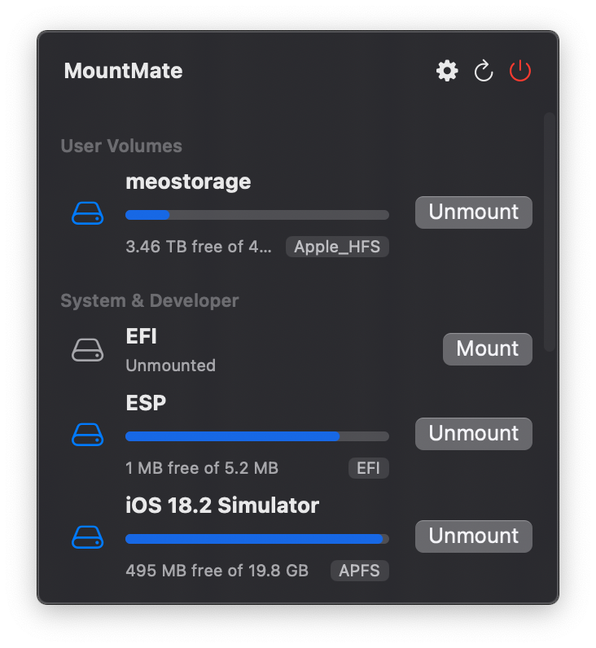

# 🚀 MountMate

_Một ứng dụng đơn giản trên thanh menu macOS giúp bạn quản lý ổ đĩa ngoài._

---



## 🧩 MountMate là gì?

MountMate là một tiện ích nhẹ dành cho macOS, chạy trên thanh menu và cho phép bạn **mount (gắn) hoặc unmount (tháo) ổ đĩa ngoài chỉ với một cú nhấp chuột** – không cần Terminal, không cần mở Disk Utility, hoàn toàn đơn giản.

Nếu bạn đang sử dụng ổ HDD, muốn kiểm soát khi nào nó hoạt động để tránh gây ồn hoặc làm chậm hệ thống, MountMate là giải pháp gọn nhẹ dành cho bạn.

## 🧠 Tại sao tôi tạo ra ứng dụng này?

Tôi có một ổ cứng ngoài 4TB được cắm thường trực vào Mac mini tại nhà. Vì là ổ HDD, mỗi lần tôi mở Finder, Spotlight hay thực hiện một số thao tác hệ thống, ổ sẽ quay lên – gây tiếng ồn, làm chậm hệ thống và không cần thiết khi tôi không dùng đến.

Các giải pháp:

- Dùng Disk Utility – quá chậm và bất tiện
- Viết script bằng shell – không thân thiện
- Tìm ứng dụng bên thứ ba – phức tạp hoặc không hiệu quả

Vì vậy, tôi đã tạo **MountMate**.

## ✅ Tính năng nổi bật

- Xem tất cả ổ đĩa ngoài đang kết nối
- Biết được ổ nào đang được **mount**
- **Mount/unmount** nhanh chóng chỉ với 1 cú click
- Hiển thị **dung lượng** của ổ đĩa và của network share đã mount (đã dùng / tổng)
- **Phím tắt**: mặc định Unmount All là `⌘⌥⇧U`, Mount All là `⌘⇧M`; đổi được trong Settings (phím hiển thị theo bố cục bàn phím hiện tại)
- **Bàn phím và VoiceOver**: các hàng trong popover nhận focus bàn phím (Tab, Lên/Xuống; Return hoặc Space để mount/unmount trên macOS 14+), VoiceOver có action cho từng hàng, animation tắt khi bật Reduce motion
- **Chặn tự mount USB**: ngăn các ổ đã chọn tự mount khi cắm hoặc khi đăng nhập; **Block at Startup** (tuỳ chọn) ghi thêm một rule vào `/etc/fstab` và hỏi mật khẩu quản trị
- **Điểm mount tuỳ chỉnh**: mount phân vùng tại đường dẫn bạn chọn (chuột phải → Custom Mount Point…), hoặc network share vào thư mục bạn chọn
- **Ổ APFS mã hoá**: mở khoá ngay trong MountMate, có thể lưu mật khẩu vào Keychain ("Forget Saved Password" trong menu chuột phải để xoá)
- **RAID**: Apple RAID hiện thành một ổ thay vì từng thành viên
- **Tuỳ chọn hiển thị** (Settings → General → Display): **Show Count in Menu Bar** hiện số phân vùng và share đang mount (không tính phân vùng được bảo vệ) cạnh biểu tượng; **Show Internal Disks** hiện cả ổ trong của máy; **Show Only Volumes** ẩn dòng ổ đĩa, chỉ liệt kê phân vùng; **Hide EFI Partitions** ẩn phân vùng EFI
- **Ignore, Protect, Pin**: chuột phải một phân vùng để **Ignore** (ẩn đi, ví dụ phân vùng hệ thống), **Protect** (không bị "Unmount All" và unmount khi ngủ) hoặc **Pin to Top** (xếp lên đầu); xem lại các danh sách trong Settings → Management
- **Network Shares**: tự mount SMB, NFS và AFP khi đăng nhập
- **Keep Alive**: tự kết nối lại share và ổ khi bị rớt, sau khi đổi mạng, khi máy thức dậy và khi đăng nhập
- **Copy Path / Open in Terminal**: chuột phải một phân vùng hoặc chia sẻ mạng đã gắn để sao chép đường dẫn hoặc mở cửa sổ Terminal tại thư mục đó
- **Tự ngắt khi không dùng**: chọn cho từng phân vùng trên ổ ngoài (chuột phải → Unmount When Idle) để tự unmount sau 1–60 phút ổ không đọc/ghi; không bao giờ ép buộc, phân vùng đang dùng sẽ được giữ nguyên và thử lại sau
- **Thông báo** (tuỳ chọn, mặc định tắt; Settings → General → Behavior): báo khi Keep Alive không kết nối lại được và khi đã nối lại (một lần mỗi đợt mất kết nối), khi không unmount được ổ bị chặn, khi unmount trước lúc ngủ không kịp, và khi một phân vùng bị unmount vì không dùng
- **Force Eject**: ép eject ổ đang được sử dụng
- **VoiceOver**: các nút chỉ có biểu tượng và biểu tượng thanh menu được đọc tên
- **Đa ngôn ngữ**: 7 ngôn ngữ, đúng dạng số nhiều
- Chạy gọn nhẹ trên **thanh menu**
- 100% native – không dùng Electron; phụ thuộc duy nhất là [Sparkle](https://sparkle-project.org) để tự cập nhật (Settings → About & Updates, nơi tắt được kiểm tra tự động; header popover có nút Check for Updates). Bản cập nhật tìm thấy khi kiểm tra tự động không bật cửa sổ đè lên việc đang làm: icon menu bar có chấm nhỏ và popover hiện dòng "MountMate X.Y is available — View…"; bấm View… mới mở cửa sổ cập nhật

## ✨ MountMate dành cho ai?

macOS sẽ tự động mount ổ đĩa khi bạn cắm vào – nhưng **không cho phép bạn mount lại một cách dễ dàng nếu đã unmount**. MountMate đặc biệt hữu ích nếu bạn:

- Sử dụng ổ ngoài chỉ để sao lưu hoặc lưu trữ tạm thời
- Không muốn ổ cứng quay suốt cả ngày
- Muốn giảm tiếng ồn, tăng hiệu năng hệ thống

## 🔐 An toàn, nhanh, và riêng tư

MountMate hoạt động **hoàn toàn ngoại tuyến**, sử dụng lệnh và API tích hợp sẵn của macOS. Ứng dụng:

- **Không theo dõi** hay gửi dữ liệu
- **Không cần internet**, trừ khi kiểm tra bản cập nhật (Sparkle)
- **Không truy cập dữ liệu cá nhân**
- **Không chạy với quyền root**: chỉ hỏi mật khẩu quản trị khi ghi `/etc/fstab` (điểm mount tuỳ chỉnh của phân vùng, Block at Startup)

Chỉ là một tiện ích nhỏ gọn, làm đúng một việc – và làm tốt.

## 🖼️ Hình ảnh minh họa




## ⚡️ Bắt đầu nhanh

Cài bằng [Homebrew](https://brew.sh):

```bash
brew install mountmate
```

Hoặc [tải `.dmg` mới nhất](https://github.com/homielab/mountmate/releases) rồi kéo MountMate.app vào thư mục Applications.

## 🛠️ Hướng dẫn cài đặt

### Yêu cầu

- macOS 13 Ventura trở lên

### Cài bằng Homebrew

```bash
brew install mountmate
```

### Cài thủ công (dành cho người mới hoặc cập nhật thủ công)

1. [Tải về `.dmg` bản mới nhất](https://github.com/homielab/mountmate/releases)
2. Mở file `.dmg`
3. Kéo biểu tượng `MountMate.app` vào thư mục **Applications**
4. Eject (gỡ) ổ đĩa cài đặt
5. Mở MountMate từ thư mục **Applications**

### Lần đầu sử dụng

- Nếu macOS cảnh báo ứng dụng không rõ nguồn gốc, hãy vào:  
  **System Settings → Privacy & Security → Open Anyway**
- Đảm bảo bạn kết nối mạng để macOS xác minh; các bản cập nhật sau đó do Sparkle tự tải (Settings → About & Updates)
- MountMate chỉ hỏi mật khẩu quản trị để sửa `/etc/fstab` ("Also Block at Startup", điểm mount tuỳ chỉnh); Full Disk Access (System Settings → Privacy & Security) giúp đọc ổ trong thư mục được bảo vệ

## 🔐 Lỗi network share

Khi một share SMB hoặc AFP không mount được, MountMate nêu nguyên nhân và điều cần kiểm tra, kèm mã lỗi gốc (ví dụ `Error code: 80 (EAUTH)`). Hãy gửi kèm dòng này khi báo lỗi.

- **Xác thực thất bại (`EAUTH`)**: sai tên đăng nhập hoặc mật khẩu. Với tài khoản domain Windows, nhập `DOMAIN\user` hoặc `user@domain` (`DOMAIN;user` cũng được).
- **Bị từ chối truy cập (`EACCES`)**: server nhận kết nối nhưng không cho tài khoản này dùng share. Kiểm tra quyền của tài khoản; nếu lỗi bắt đầu sau khi server cập nhật, hỏi quản trị viên xem server còn chấp nhận SMB 2/3 với đăng nhập NTLMv2 không.
- **Mật khẩu hết hạn, chính sách, tài khoản bị hạn chế (`ENETFSPWDNEEDSCHANGE`, `ENETFSPWDPOLICY`, `ENETFSACCOUNTRESTRICTED`)**: phải xử lý tài khoản phía server.
- **Không có cách đăng nhập hoặc phiên bản giao thức được hỗ trợ (`ENETFSNOAUTHMECHSUPP`, `ENETFSNOPROTOVERSSUPP`)**: server phải cho phép NTLMv2/Kerberos và SMB 2 hoặc 3.
- **Không thấy share (`ENOENT`)**, **kết nối bị từ chối (`ECONNREFUSED`)**, **không tới được server (`EHOSTUNREACH`)**: kiểm tra tên share, File Sharing đã bật chưa và mạng.

## 🪵 Gửi log khi báo lỗi

Khi báo lỗi (ví dụ ổ mạng không mount được), log giúp tìm nguyên nhân nhanh hơn. MountMate ghi vào unified log của macOS với subsystem `com.homielab.mountmate`.

Làm lại thao tác bị lỗi, rồi chạy trong Terminal và đính kèm file `mountmate.log` vào issue:

```bash
log show --predicate 'subsystem == "com.homielab.mountmate"' --last 1h --info > ~/Desktop/mountmate.log
```

Xem trực tiếp khi mount/unmount: `log stream --predicate 'subsystem == "com.homielab.mountmate"' --level info`, hoặc lọc theo subsystem này trong Console.app. Mật khẩu không bao giờ được ghi; tên share, tên ổ, đường dẫn và chi tiết lỗi hiện là `<private>`.

## 🧑‍💻 Phát triển

Mở `MountMate.xcodeproj` trong Xcode, hoặc dùng dòng lệnh:

```bash
# Unit test (ký ad-hoc, cùng lệnh với CI)
xcodebuild test -project MountMate.xcodeproj -scheme MountMate \
  -destination 'platform=macOS' -derivedDataPath build/DerivedData \
  -only-testing:MountMateTests CODE_SIGN_IDENTITY="-" CODE_SIGNING_REQUIRED=NO

# Kiểm tra code style (cấu hình trong .swift-format)
swift format lint -r MountMate MountMateTests
```

App build ở chế độ ngôn ngữ Swift 5 với strict concurrency `targeted`; unit test dùng chế độ Swift 6. Kiểu giá trị mới trong `Models/` và `Utilities/` được truyền giữa các queue thì đánh dấu `Sendable`, và giữ build không có cảnh báo concurrency.

Ghi log bằng `Log.<category>` (`MountMate/Utilities/Log.swift`), không dùng `print()`. Tên share/ổ, đường dẫn và nội dung lỗi dùng `privacy: .private`, không bao giờ ghi mật khẩu, và dòng lệnh đi qua `redactedArguments`; `LoggingHygieneTests` kiểm tra điều này.

Mỗi lần làm mới chỉ chạy `diskutil list` một lần và `diskutil info` cho những ổ mới, ổ đổi dung lượng hoặc bố cục phân vùng, hoặc ổ có thông tin cũ hơn 30 giây (`WholeDiskInfoCache`); các lệnh chạy song song, không chặn thread. Số lần chạy `diskutil info` được ghi ở mức debug: `log stream --predicate 'subsystem == "com.homielab.mountmate" AND category == "drive"' --level debug`.

Danh sách ổ được dựng bởi `DiskListParser` (`MountMate/Managers/DiskListParser.swift`), vốn không tự chạy tiến trình nào: statfs và phương án dự phòng Disk Arbitration được truyền vào. `DiskListParserTests` chạy nó trên một bản `diskutil list -plist` ghi sẵn trong `MountMateTests/Fixtures/`; cần kiểm một bố cục ổ mới thì thêm fixture vào đó.

Mã cho `/etc/fstab` chia làm ba: `FstabRules` (`MountMate/Managers/FstabRules.swift`) dựng, tìm, xoá các dòng của MountMate và kiểm từng trường, toàn hàm thuần không đụng file; `FstabVolumeLookup` hỏi `diskutil` định dạng của volume và volume có được chặn lúc khởi động không; `FstabWriter` đọc `/etc/fstab` và ghi nó qua hộp thoại mật khẩu quản trị. Kiểm thay đổi quy tắc trong `FstabRulesTests` và `BlockedFstabRuleTests`; lệnh đặc quyền được kiểm trên một file tạm, không bao giờ trên `/etc/fstab` thật.

Share mạng được đọc từ bảng mount của kernel bởi `MountTable` (`MountMate/Utilities/MountTable.swift`, `getfsstat` với `MNT_NOWAIT`: không chạy tiến trình, không bao giờ chờ server). `MountedNetworkShare` (`MountMate/Models/`) là một mục SMB/NFS/AFP và biết nó là share đã lưu nào; `NetworkMountManager.importedShare(from:)` biến share kết nối trong Finder thành `NetworkShare` để nhập, còn câu lỗi NetFS nằm ở `MountMate/Utilities/NetFSErrorMessages.swift`. Test: `MountTableTests` và `NetworkShareParsingTests`.

CI chạy cả hai trên mỗi pull request và mỗi push vào `main`; kiểm tra style ở chế độ strict. Xem quy ước trong [CONTRIBUTING.md](CONTRIBUTING.md) (bằng tiếng Anh).

### Phát hành

Push một tag phiên bản (`git tag v6.4 && git push origin v6.4`, hoặc `scripts/create-draft-release.sh`): workflow release đặt version và build number, build, ký và notarize app và DMG, cập nhật `docs/appcast.xml` và cask Homebrew trên `main`, rồi đăng GitHub release với mục của phiên bản đó trong `CHANGELOGS.md`. Hãy viết mục đó cho người dùng: `scripts/2-build.sh` chuyển nó sang HTML (`scripts/changelog-to-html.sh`) và nhúng vào item mới của appcast, nên cửa sổ cập nhật của Sparkle hiện nó. Appcast giữ ba phiên bản mới nhất.

Kiểm zip và appcast trên máy mà không tạo DMG, không ký, không notarize (`docs/appcast.xml` giữ nguyên; kết quả ở `Dist/Final/`):

```bash
# Dist/Release/MountMate.app = một bản build Release bất kỳ trên máy; dùng một file khoá EdDSA thử
SPARKLE_PRIVATE_KEY=/path/to/test_key scripts/2-build.sh --dry-run
```

`scripts/0-run-all.sh` chạy toàn bộ bước build trên máy (cần `.env.local` có chứng chỉ ký, notary profile và khoá Sparkle) và không đăng gì cả.

## 📫 Đóng góp & phản hồi

MountMate được tạo để giải quyết nhu cầu cá nhân của tôi – nhưng tôi rất sẵn lòng cải thiện nó cho cộng đồng.
Nếu bạn có góp ý hoặc muốn tham gia phát triển, [hãy mở issue tại đây](https://github.com/homielab/mountmate/issues) (form báo lỗi hỏi mã lỗi và log)! Pull request cũng được chào đón: xem [CONTRIBUTING.md](CONTRIBUTING.md).

## 🤝 Hỗ trợ

Nếu bạn thấy MountMate hữu ích, hãy ủng hộ phát triển:

[](https://ko-fi.com/homielab)
