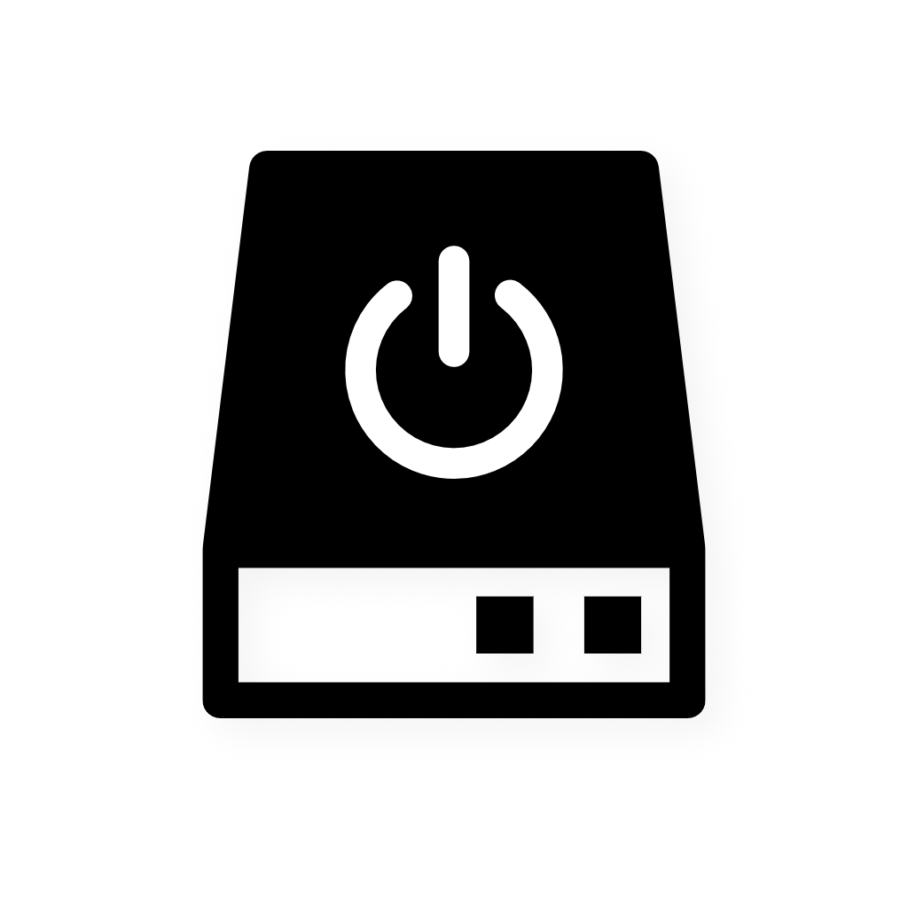
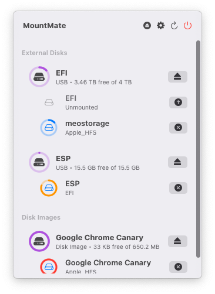
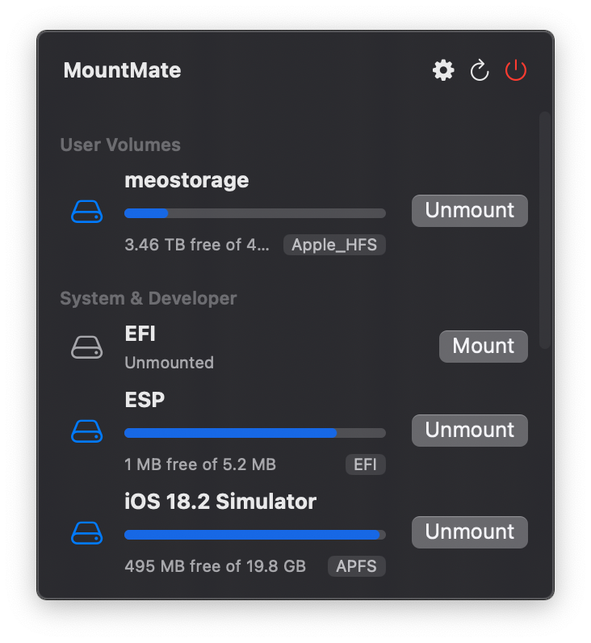

# 🚀 MountMate

_A simple macOS menu bar app to manage your external drives._

<p align="center">
  
</p>

<p align="center">
  <a href="https://github.com/homielab/mountmate/actions/workflows/release.yml">
    
  </a>
  <a href="https://github.com/homielab/mountmate/releases">
    
  </a>
  <a href="https://github.com/homielab/mountmate">
    
  </a>
  <a href="https://brew.sh">
    
  </a>
</p>

---

## ⚡️ Quick Start

Install via [Homebrew](https://brew.sh):

```bash
brew install mountmate
```

Or [download the latest .dmg](https://github.com/homielab/mountmate/releases) and drag MountMate.app into your Applications folder.

## 🖼️ Screenshots




## ✅ Features

- Mount, unmount, mount read-only and force eject any external drive from the menu bar with one click.
- See free space for drives and mounted network shares at a glance.
- Unmount All, Mount All and Eject All External Disks from the popover or with global keyboard shortcuts, and Mount or Unmount All Network Shares with their own shortcuts.
- Unmount disks when the Mac sleeps, when the screen locks or after they sit idle, and mount them again on wake or unlock.
- Stop USB disks from auto-mounting at plug-in or login, optionally also at startup (`/etc/fstab`).
- Mount a volume or network share at a mount point you choose.
- Unlock encrypted APFS volumes, with the password saved in the Keychain if you want.
- Auto-mount SMB, NFS and WebDAV (Nextcloud, Synology) shares at login (existing AFP shares supported with deprecation notice), and let Keep Alive reconnect them when they drop.
- Get "Almost full" and SMART warnings, plus optional notifications.
- Ignore, Protect or Pin volumes, show Apple RAID as one disk, and tune what the popover lists.
- Automate it with thirteen Shortcuts actions (Spotlight, Siri and Automator too) that hand mount points and mount state to the next step.
- Fully native (no Electron), localized in 7 languages, with keyboard and VoiceOver support; the only dependency is Sparkle for updates.

See [FEATURES.md](FEATURES.md) for what each one does.

## 🧩 What is MountMate?

MountMate is a lightweight macOS menu bar utility that lets you **mount and unmount external drives with a single click** – no Terminal, no Disk Utility, no hassle.

Whether you're dealing with a noisy spinning HDD or want finer control over when your drives are active, MountMate gives you a clean, no-nonsense solution right from your menu bar.

## 🧠 Why I Built It

I have a 4TB external HDD plugged into my Mac mini 24/7. Since it's a spinning drive, macOS constantly spins it up – just for trivial things like opening Finder or running Spotlight. That meant:

- Unwanted noise
- System slowdowns
- Wasted energy

I tried:

- Disk Utility – too slow and clunky
- Custom shell scripts – too technical
- Existing third-party apps – too bloated or didn’t work right

So I built **MountMate**.


## ✨ Why Use MountMate?

macOS automatically mounts drives when they’re plugged in – but gives you **no easy way to remount them later** unless you use Terminal or Disk Utility. MountMate is perfect for:

- External HDDs you don’t always need
- Drives used only for backup
- Reducing wear and tear or noise
- Improving system responsiveness
- Network shares that silently drop and need reconnecting

## 🔐 Private, Fast, and Safe

MountMate runs **entirely offline**, using native macOS APIs and command-line tools. It:

- Does **not** track anything
- Does **not** need the internet, except to check for updates (Sparkle)
- Does **not** access your files
- Does **not** run as root: it asks for your admin password only to write `/etc/fstab` (custom mount points of volumes, Block at Startup)

Just a clean utility that does one job well.

## 🛠️ Installation

### Requirements

- macOS 13 Ventura or later

### Manual Installation

1. [Download the latest `.dmg` release](https://github.com/homielab/mountmate/releases)
2. Open the `.dmg` file
3. Drag `MountMate.app` into the **Applications** folder
4. Eject the installer disk image
5. Launch MountMate from **Applications**

### Install via Homebrew

If you have [Homebrew](https://brew.sh) installed, you can install MountMate directly from this repository:

```bash
brew install mountmate
```

### First launch

- If macOS warns about an app from an unidentified developer, go to **System Settings → Privacy & Security → Open Anyway**.
- Stay online so macOS can verify the app; later updates are downloaded by Sparkle (Settings → About & Updates).
- Some features need extra permission: MountMate asks for your administrator password only to edit `/etc/fstab` ("Also Block at Startup", custom mount points), and Full Disk Access (System Settings → Privacy & Security) lets it read volumes in protected folders.

## 🧑‍💻 Development

Build, tests, architecture and releases: see [DEVELOPMENT.md](DEVELOPMENT.md). Conventions: [CONTRIBUTING.md](CONTRIBUTING.md).

## 🔐 Network Share Errors

When an SMB or AFP share fails to mount, MountMate names the cause and what to check, followed by the original error code (for example `Error code: 80 (EAUTH)`). Please include that line when you report a problem.

- **Authentication failed (`EAUTH`)**: wrong username or password. For a Windows domain account, enter the username as `DOMAIN\user` or `user@domain` (`DOMAIN;user` works too).
- **Access denied (`EACCES`)**: the server accepted the connection but refused this account for the share. Check the account's permissions; if it started after a server update, ask the administrator whether the server still accepts SMB 2/3 with NTLMv2 sign-in.
- **Password expired, policy, account restricted (`ENETFSPWDNEEDSCHANGE`, `ENETFSPWDPOLICY`, `ENETFSACCOUNTRESTRICTED`)**: the account must be fixed on the server side.
- **No supported sign-in method or protocol version (`ENETFSNOAUTHMECHSUPP`, `ENETFSNOPROTOVERSSUPP`)**: the server must allow NTLMv2/Kerberos and SMB 2 or 3.
- **Share not found (`ENOENT`)**, **connection refused (`ECONNREFUSED`)**, **server unreachable (`EHOSTUNREACH`)**: check the share name, that file sharing is on, and the network.

## 🪵 Sending Logs

When you report a problem (for example a network share that will not mount), logs help a lot. MountMate writes to the macOS unified log under the subsystem `com.homielab.mountmate`, with one category per area (`drive`, `network`, `keepAlive`, `persistence`, `mounter`, `hotkey`, `shell`, `app`).

Easiest: reproduce the problem, open **Settings → General → Logs** and click **Copy Diagnostics**, then paste the result into your issue. The report has the MountMate and macOS versions, your on/off settings and the last hour of MountMate's log. It has no passwords, paths, or disk and share names (only counts: disks by connection and file system, disks reporting a failing SMART status, volumes almost full).

Fallback: run this in Terminal and attach `mountmate.log` to your issue:

```bash
log show --predicate 'subsystem == "com.homielab.mountmate"' --last 1h --info > ~/Desktop/mountmate.log
```

To watch live while you mount or unmount: `log stream --predicate 'subsystem == "com.homielab.mountmate"' --level info`. You can also filter on the same subsystem in Console.app. Passwords are never logged; share names, volume names, paths and error details appear as `<private>`.

## 📫 Feedback & Contributions

MountMate was built to solve my personal workflow issue, but I’d love to improve it for others too.
Feel free to [open an issue](https://github.com/homielab/mountmate/issues) (the form asks for the error code and a log) or suggest improvements! Pull requests are welcome too: see [CONTRIBUTING.md](CONTRIBUTING.md).

## 🤝 Support

If you found MountMate helpful, please consider supporting its development:

[](https://ko-fi.com/homielab)
